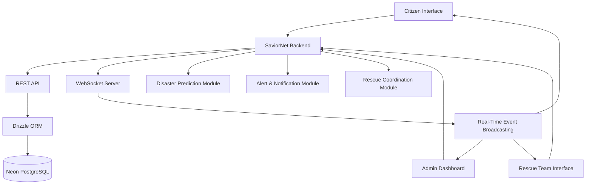

# 🌍 SaviorNet — AI-Powered Disaster Management & Emergency Response Platform

<p align="center">
  <strong>Predict. Respond. Rescue. Rebuild.</strong>
</p>

<p align="center">
  An intelligent disaster management platform designed to improve emergency coordination, streamline rescue operations, and connect citizens, administrators, and rescue teams through a unified digital ecosystem.
</p>

<p align="center">
  
  
  
  
  
</p>

---

## 🚨 About the Project

Natural disasters and emergencies demand rapid communication, accurate information, and coordinated response operations.

However, fragmented communication, delayed emergency reporting, limited resource visibility, and inefficient coordination can make disaster response more challenging.

**SaviorNet** aims to address these challenges through a centralized disaster management and emergency response platform.

It brings together emergency SOS reporting, rescue-team coordination, shelter management, disaster alerts, and prediction capabilities into one unified system.

The goal is simple:

**Help people get assistance faster, help rescue teams coordinate better, and help administrators make informed decisions.**

## ✨ Key Features

### 🆘 1. Emergency SOS Management
- Submit emergency SOS requests.
- Capture emergency details and location information.
- Store reported incidents in the central database.
- Broadcast new SOS incidents to connected dashboards.
- Track victim rescue and assignment statuses.

### 🚑 2. Rescue Team Coordination
- Manage rescue team information.
- Monitor team availability and operational status.
- Assign rescue teams to reported emergencies.
- Update rescue team locations.
- Coordinate team availability after rescue completion.

### 🏠 3. Shelter Management
- Maintain shelter information.
- Monitor shelter occupancy.
- Update available capacity.
- Support centralized visibility of shelter resources.

### 🌦️ 4. Disaster Prediction & Risk Analysis
- Generate disaster-risk predictions.
- Support flood, earthquake, and wildfire scenarios.
- Categorize predictions into risk levels.
- Generate prediction descriptions and affected-area information.
- Provide an ensemble-style simulation for exploring prediction workflows.

> Current implementation note: The prediction endpoint uses simulated model outputs. Integration with trained machine-learning models and verified live disaster data is part of the planned development roadmap.

### 🔔 5. Real-Time Disaster Alerts
- Create and manage disaster alerts.
- Categorize alerts by severity.
- Activate and deactivate alerts.
- Broadcast newly generated alerts through WebSockets.
- Support email notification workflows for critical alerts.

### 📡 6. Real-Time Communication
- WebSocket-based communication.
- Live event broadcasting to connected clients.
- Initial data delivery when a client connects.
- Real-time SOS, rescue assignment, team location, and incident updates.

### 📊 7. Centralized Disaster Monitoring
- Retrieve disaster predictions.
- View active alerts.
- Monitor rescue teams.
- Access victim and shelter information.
- Use REST APIs for data exchange between frontend and backend.

## 🏗️ System Architecture



## 🛠️ Technology Stack

| Category | Technologies |
|---|---|
| Frontend | React, TypeScript, Vite |
| Backend | Node.js, Express.js |
| Database | PostgreSQL, Neon |
| ORM | Drizzle ORM |
| Real-time communication | WebSocket (`ws`) |
| API | REST API |
| Validation | Zod |
| Development | VS Code, Git, GitHub |

## 🔄 How SaviorNet Works

1. **Incident Reporting:** A citizen reports an emergency through the platform.
2. **Data Processing:** The backend validates and stores the emergency information.
3. **Live Broadcasting:** The WebSocket server broadcasts the incident to connected clients.
4. **Emergency Coordination:** Administrators can review the incident and assign an available rescue team.
5. **Rescue Operations:** Team status and location information can be updated.
6. **Incident Resolution:** The victim's status can be updated after rescue.
7. **Monitoring:** Alerts, predictions, rescue teams, and shelters can be monitored through the platform.

## 🗄️ Database & Backend

SaviorNet uses **Neon PostgreSQL**, a cloud-hosted PostgreSQL database.

Drizzle ORM provides database access and schema management.

The backend provides API operations for:

- Victims
- Rescue teams
- Shelters
- Disaster predictions
- Emergency alerts

The application also uses WebSockets to broadcast relevant operational events to connected clients.

## 🔌 API Endpoints

| Method | Endpoint | Purpose |
|---|---|---|
| GET | `/api/victims` | Retrieve victims |
| POST | `/api/victims` | Create an SOS/victim record |
| GET | `/api/rescue-teams` | Retrieve rescue teams |
| POST | `/api/rescue-teams` | Register a rescue team |
| PATCH | `/api/rescue-teams/:id/status` | Update team status |
| PATCH | `/api/rescue-teams/:id/location` | Update team location |
| GET | `/api/shelters` | Retrieve shelters |
| POST | `/api/shelters` | Create a shelter |
| PATCH | `/api/shelters/:id/occupancy` | Update shelter occupancy |
| GET | `/api/predictions` | Retrieve predictions |
| POST | `/api/predictions` | Create a prediction |
| POST | `/api/simulate/prediction` | Generate a simulated prediction |
| GET | `/api/alerts` | Retrieve alerts |
| POST | `/api/alerts` | Create an alert |
| PATCH | `/api/alerts/:id/deactivate` | Deactivate an alert |

### WebSocket

```text
/ws
```

The WebSocket server supports events such as:

- `initial_data`
- `new_sos`
- `team_assigned`
- `team_location_updated`
- `victim_rescued`
- `new_prediction`
- `new_alert`
- `alert_deactivated`

## 🚀 Getting Started

Follow these steps to run SaviorNet locally.

### Prerequisites

- Node.js and npm
- Git
- A Neon PostgreSQL account
- Visual Studio Code (recommended)

### 1. Clone the repository

```bash
git clone https://github.com/SyedaUmmeHaani23/SaviorNet.git
```

### 2. Navigate into the project

```bash
cd SaviorNet
```

### 3. Install dependencies

```bash
npm install
```

### 4. Configure environment variables

Create a `.env.local` file in the project root.

Add your Neon PostgreSQL connection string:

```env
DATABASE_URL=your_neon_postgresql_connection_string
```

Replace the placeholder with your own database connection string.

**Never commit `.env.local` or expose database credentials in GitHub.**

### 5. Apply the database schema

```bash
npm run db:push
```

### 6. Start the development server

```bash
npm run dev
```

Open the application in your browser:

```text
http://localhost:5000
```

## 📁 Project Structure

```text
SaviorNet/
│
├── client/
│   └── src/
│       ├── components/
│       ├── context/
│       ├── hooks/
│       └── pages/
│
├── server/
│   ├── db.ts
│   ├── index.ts
│   ├── routes.ts
│   ├── storage.ts
│   └── emailService.ts
│
├── shared/
│   └── schema.ts
│
├── migrations/
│
├── drizzle.config.ts
├── package.json
├── package-lock.json
└── README.md
```

## 🔮 Future Enhancements

SaviorNet is designed to evolve into a more intelligent and comprehensive emergency response ecosystem.

Planned improvements include:

- Integration of trained machine-learning models for disaster-risk prediction.
- Live weather and environmental data integration.
- Interactive geospatial disaster monitoring.
- GPS-based rescue-team tracking.
- Role-based authentication for citizens, administrators, and rescue teams.
- SMS and push notifications for emergency communication.
- Advanced disaster analytics and reporting.
- Mobile-responsive emergency reporting experience.
- Production deployment with monitoring, security, and database backup strategies.

## 🎯 Project Objectives

- Improve emergency incident reporting.
- Enable faster communication between stakeholders.
- Improve rescue-team coordination.
- Increase visibility of shelter resources.
- Support disaster-risk awareness and preparedness.
- Build a centralized digital ecosystem for disaster response.

## 👩‍💻 Development

**SaviorNet** is being developed as a software engineering project focused on applying modern web technologies, database systems, and real-time communication to disaster management.

## 🤝 Contributions

Contributions, suggestions, and feedback are welcome.

1. Fork the repository.
2. Create a feature branch.
3. Make your changes.
4. Commit your changes.
5. Submit a pull request.

## 📜 License

This project currently does not specify a license. A license can be added to clarify permissions for reuse and distribution.

---

<p align="center">
  <strong>🌍 SaviorNet — Because every second matters when lives are at stake.</strong>
</p>

<p align="center">
  Built with purpose. Driven by technology. Designed for impact.
</p>
